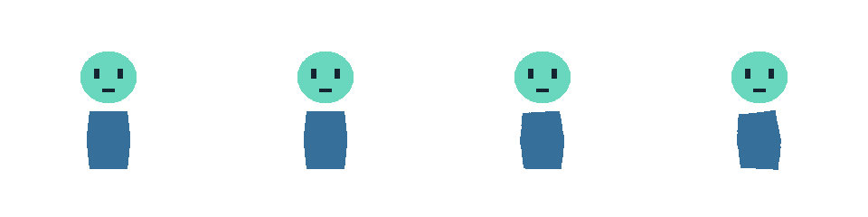

# 001-baseline: 既存の第一段階

元記録を移動・改変せず参照する。対象上流コミット `c3166aa138f07bc289027c7a9060fc64cc0f082a`、記録コミット `6b9b588`。実行日2026-11-15 UTC。

| 成果物 | 保存場所 |
|---|---|
| 技術報告 | [REPORT.ja.md](../../validation/REPORT.ja.md) |
| 依存導入 | [npm-ci-retry.log](../../validation/artifacts/npm-ci-retry.log) |
| ビルド | [build.log](../../validation/artifacts/build.log) |
| 公式テスト最終実行 | [npm-test-final.log](../../validation/artifacts/npm-test-final.log) |
| MCP要求・確定・復元 | [要求](../../validation/artifacts/bend-request.json)、[確定](../../validation/artifacts/bend-commit.json)、[復元](../../validation/artifacts/restore.json) |
| QA | [編集前](../../validation/artifacts/qa-before.json)、[編集後](../../validation/artifacts/qa-after.json) |
| 変形比較PNG | [comparison.png](../../validation/artifacts/comparison.png) |
| ブラウザPNG | [Canvas](../../validation/artifacts/browser-canvas.png)、[WebGL](../../validation/artifacts/browser-webgl.png) |
| ブラウザ判定・モーション | [判定](../../validation/artifacts/browser-results.json)、[時間変化](../../validation/artifacts/motion-states.json) |
| 途中の失敗ログ | [初回test](../../validation/artifacts/npm-test.log)、[依存不足test](../../validation/artifacts/npm-test-unrestricted.log)、[初回probe](../../validation/artifacts/probe.log) |

既存結果: smoke 16項目・Nodeテスト183件成功、skip0。MCP曲げ・3姿勢QA・PNG・復元成功。Canvasのメッシュ境界線、実キャラクターの髪／布の未評価を残す。今回はこれらの実験を再実行していない。

