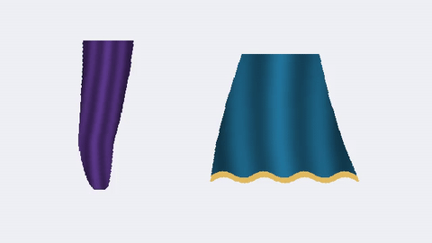

# 003: 髪1束・スカート裾1枚の自動メッシュと8秒ループ

実行: 2026-11-15 12:03–12:09 UTC。開始コミット `1fdcfed3d6464c82cdc9293d0702c110821d6c6e`。ブランチ `experiment/rigging-validation-20261115`。追加課金・購入・外部推論APIなし。SONY共同プロジェクトにはアクセスしていない。

**結果: オリジナル合成素材から、メッシュ・拘束・形状・物理・8秒のMP4をコードだけで生成できた。自然な髪・衣装としての品質合格には至っていない。** 素材の役割・上下方向・寸法が既知の専用アルゴリズムであり、任意のキャラクター絵から意味や拘束をAIが推定した実験ではない。

## 動画・画像・コード

- [MP4: 8秒 / 640×360 / 30fps / H.264](hair-skirt-loop.mp4)（約232 KiB、240フレーム、音声なし）
- [GIF: 8秒 / 480×270 / 15fps / 無限ループ](preview.gif)
- [240枚の連続PNG](frames/)、[0秒と比較した8秒のPNG](loop-endpoint.png)、[物理出力ゼロの中立](neutral.png)
- [8姿勢の一覧](contact-sheet.png)（上段0/1/2/3秒、下段4/5/6/7秒、全コマ同じカメラ）
- [髪素材](assets/hair.png)、[裾素材](assets/skirt.png)、[素材ライセンス](LICENSE-ASSETS.txt)
- [生成コードの保存版](code/003-secondary-loop.mjs)、[独立検査コードの保存版](code/003-verify.mjs)
- [生成元](../../experiments/003-secondary-loop.mjs)、[検査元](../../experiments/003-verify.mjs)
- [ライブ物理用モデル](fixture.srig.json)、[ベイク再生用モデル](baked-fixture.srig.json)、[8秒StandRigモーション](baked-motion.json)
- [実行条件と素材の由来](manifest.json)、[数値結果](metrics.json)、[検査結果](verification.json)、[動画形式確認](video-probe.json)
- [生成ログ](run.log)、[検査ログ](verify.log)、[公式テスト](npm-test.log)、[MP4エンコードログ](ffmpeg.log)、[GIF生成ログ](gif-encode.log)、[動画生成コマンド](video-command.json)



## 手法・自動化範囲

1. 外部画像を使わず、数式で髪束の輪郭・筋、裾の台形・プリーツ・金色トリムをPNGに描画する。既存キャラクターの模写や流用はない。
2. StandRigの `createRectArtMesh` で各8×16セル（153頂点・256三角形）を作る。上端の全頂点を動かさないよう、UV高さから拘束と3つの曲げ影響範囲を自動計算する。UVと三角形構成は保持する。
3. 各部位の3チャネルに正負のBlend Shapeを生成し、StandRigの `evaluatePendulumPhysics` で3段振り子を60Hzで順次積分する。髪と衣装で慣性・減衰・長さを変え、裾側の変形振幅を小さくする。駆動は8秒周期＋4秒周期の合成波で、角度入力を介して振り子の重力方向を動かす。空気力学の風モデルではない。
4. 3周期＝24秒を事前計算し、同位相の出力差が収束した状態から8秒を採取する。終端の手修正、クロスフェード、同じフレームを追加する操作は行わない。冷間起動直後の8秒がそのままループすることは保証しない。
5. 60Hzの物理出力を30fpsでベイクし、StandRigの実 `resolveArtMesh` / `serverRenderer` で240枚を生成する。PNGをffmpegでMP4/GIF化する。

全頂点の手編集、手描き、フレームごとのポーズ付け、DCCソフトの操作は0回。Codexがコードで素材寸法・部位の役割・メッシュ密度・振り子定数・最大振幅を設計しており、この設計作業まで自動推定したという意味ではない。

この実験は合成fixtureの直接core実行であり、PSD編集やMCPの再検証ではない。AGENTSのPSD向け目標画像ゲートの対象外。サーバー保存ディレクトリや個人のモデル作業データは公開していない。

## 検査結果

| 検査 | 結果 |
|---|---|
| 生成時の数値チェック | 9項目成功（構造、反転、根元、周期収束、境界位置・速度、可動量、飽和、モーション） |
| 独立成果物検査 | 14項目成功。全240枚の空画像・画面端接触0。保存モーションから4姿勢を再描画してRGBA一致。MP4全フレームをデコード可能 |
| 公式npm test | schema整合、smoke16、Node183件成功、失敗0、skip0。今回実際に再実行 |
| 頂点・三角形 | 各153頂点・256三角形。全時刻で反転・縮退0、最小面積比0.827585 |
| 根元変位 | 0px（上端全頂点） |
| 先端左右可動量 | 髪210.508px、裾68.789px（メッシュ中央最下端の水平レンジ。絵の実先端や3D移動距離ではない） |
| ループ0秒→8秒の位置差 | 最大7.65×10^-14 px、PNG画素差0 |
| 同位相の速度差 | 約1.91×10^-12 px/s（60Hzの前進差分を0秒と8秒で比較） |
| ベイク境界の速度変化 | 1.472px/s。30fpsの前後差分なので0ではない。通常フレームの最大速度変化60.103px/s以下 |
| MP4 | ffprobeで8.000000秒・240枚・30/1fps・640×360を確認 |

完全に滑らかな連続速度を保証するものではない。ベイクデータは線形キーであり、通常のキー境界にも速度の変化がある。物理周期の連続性と、30fps離散再生の連続性を分けて検査した。

## 変形品質・失敗・手直し

**目視確認:** 8時刻の実描画を確認した。髪と裾の上端が静止し、下ほど変形する。筋・プリーツ・裾のトリムがメッシュと一緒に曲がる。今回のサーバー描画では大きな透明穴や三角形の裂け目は見られず、全PNGの画面切れ検査も成功。身体のない部位単独テストなので、頭皮・腰への接続は評価していない。人による動画の自然さ評価は未実施。

**残る破綻・品質上の制約:** メッシュ辺の長さ比は0.7496～1.2294。約25%縮み・約23%伸びがあり、毛髪の長さ保持や布の面積保持は不十分。髪の左右振幅は大きく、裾はほぼ平面的な曲げで、衣装の立体的な広がり・折り返し・陰影変化はない。正負Blend Shapeの合成、3つの影響開始位置、線形ベイクに由来する曲率・速度の変化が残る。見た目の自然さを合格としない。

**初回の失敗:** [初回ログ](attempts/first-run.log)、[初回数値](attempts/first-metrics.json)、[初回画像](attempts/first-contact-sheet.png)を保存した。

- 最初の制限環境ではNodeからgitを子起動する際に `spawnSync git EPERM` で中断。ローカル子プロセスの実行許可後に再実行した。有料サービスには接続しない。
- DEFAULT_TRANSFORMのpivot=0.5を座標計算で見落とし、根元が画面外に出た。pivotを[0,0]と明示するコード修正で解消。素材を手で移動・描き直す操作はない。
- 初回の速度チェックは同じ瞬間の後退差分と前進差分を比較し、通常の加速度を含む0.736px/sを不合格とした。0秒と8秒の同方向・同位相の差分を比べるよう検査方法を修正した。閾値を上げて通していない。30fpsベイクの実際の前後差分1.472px/sは別に保存し、隠していない。
- 保存モーションのキー形式を公式 `parseMotion` の仕様に合わせ、再読込・値域・241時刻の再生値を検査した。ベイク再生用モデルは物理を無効化し、物理を二重適用しない。

## 再現手順

リポジトリ直下で、対応Nodeとffmpeg/ffprobeを用意する。導入済み依存・ビルドを使用したため、今回npm ciとbuildは再実行していない。

```sh
node experiments/003-secondary-loop.mjs
node experiments/003-verify.mjs
npm test
ffmpeg -y -i results/003-secondary-loop/hair-skirt-loop.mp4 -vf 'fps=15,scale=480:-1:flags=lanczos,split[s0][s1];[s0]palettegen[p];[s1][p]paletteuse' -loop 0 results/003-secondary-loop/preview.gif
```

StandRig UIでモーションを再生する場合は `baked-fixture.srig.json` を読み込み、その後 `baked-motion.json` を読み込んでループ再生する。これは今回生成したデータの使い方であり、この組合せのブラウザGUI操作を今回実施したという意味ではない。`fixture.srig.json` は物理オンのライブ用で、ベイク済み出力の再生とは用途が異なる。

## 次の実験とChatGPTへの依頼

1. GIF/MP4を見て、髪・裾の振幅、曲率、速度の変化を評価する。画像だけで自然さを断定しない。
2. 髪は長さを保つ連続中心線＋スキニング、布は複数列の横方向拘束へ置き換え、今回と同じ入力で伸縮率と見た目を比較する。
3. 正負中間形状を増やすか滑らかな非線形補間を導入し、最大速度変化60.103px/sを減らせるか確認する。
4. 頭皮・腰の固定素材を追加し、重なり・接続・身体貫通を評価する。現状は衝突・自衝突・3D奥行きを実装していない。
5. 自由形状の髪素材に対する根元・中心線・拘束の推定を追加し、既知寸法の専用自動化から汎用性を検証する。

これらはCodexの次段階候補。ChatGPTによる技術レビューは未実施。
