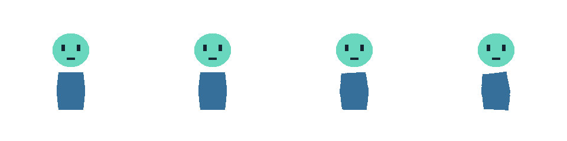
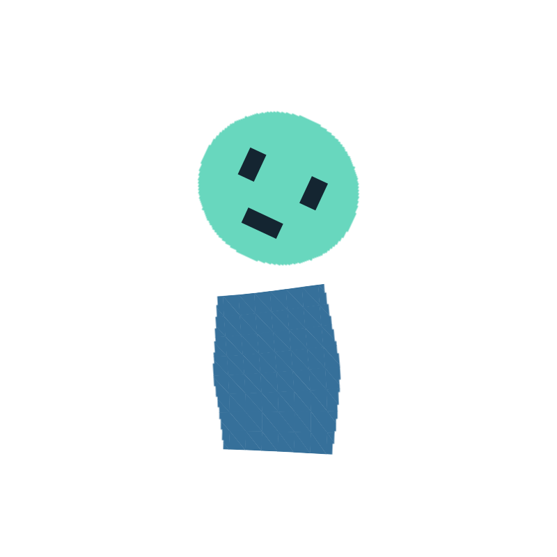
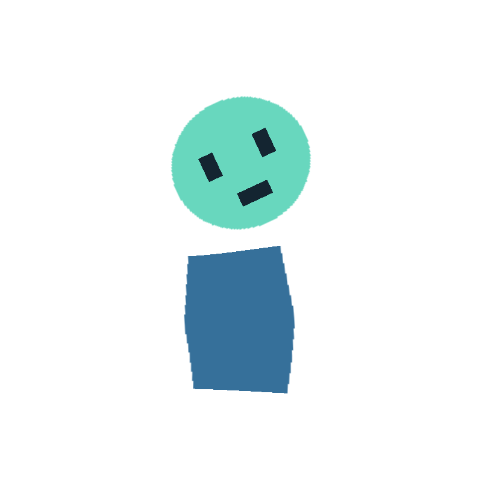

# StandRig 技術検証（第一段階）

検証日: 2026-11-15。対象: https://github.com/sayaka-aiart/StandRig 、commit `c3166aa138f07bc289027c7a9060fc64cc0f082a`（0.2.0）。独立clone `/workspace/standrig-experiment`、実験ブランチ `experiment/rigging-validation-20261115`。Linux / Node v24.22.1 / npm 11.9.0 / Chromium headless。原本へのpushや製品ソースの変更は行っていない。SONY関連のコード、素材、サービス、認証情報は使用していない。有料API・購入・画像生成APIは利用していない。

## 判定

**AIから操作できる2D変形・再生エンジンとしての基本動作は確認できた。放置少女のような高品質な髪・衣装の自動制作は、今回の結果では実証できていない。** 公式READMEも「PSDを読み込むだけでは完成した動きは付かない」と明記する。完成済みのキャラクターPSDは同梱されず、今回の素材は付属の合成図形 Sample Bot のみ。

## 実行結果

| 項目 | 結果 | 証拠・範囲 |
|---|---|---|
| 公式README・コード調査 | 完了 | README、AGENTS、AI_OPERATING_GUIDE、API/MCP/DEFORM/RIG-FEATURES、core/runtime/service/MCP実装・テストを確認 |
| npm ci | 成功 | `artifacts/npm-ci-retry.log`。ロックされた依存47パッケージ |
| npm run build | 成功 | `artifacts/build.log`。core/runtime/service TypeScript、preview Viteをビルド |
| npm test | 成功 | `artifacts/npm-test-final.log`。schemas整合、smoke 16項目、Nodeテスト183件成功、失敗0、skip0 |
| サンプル起動・再生 | 成功 | 独立データディレクトリ・127.0.0.1:5186。Canvas/WebGLページで非透明画素を確認。SSE入力変更後にPNGが変化 |
| MCPによるAI編集 | 成功 | 実際のstdio SDK接続、21ツール検出、contract/guide読取、context/part確認、メッシュ生成＋bendのdry-run→commit→QA→render→restore |
| 曲げ・変形 | 限定成功 | bodyを8×8セル（81頂点）にし、ParamAngleX=0/15/30で形状を確認。公式テストでは6種ブラシ、ロック、UV/位相保持、三角形反転拒否も検証 |
| PNG生成・比較 | 成功 | サーバー240px描画とブラウザ800px描画を保存。Canvasに視覚上の課題あり（後述） |
| 髪・スカート・リボンの実キャラクター評価 | 未実施 | パーツ分け済みの対象PSDなし。自然な揺れ、重なり、隠れた絵の露出、接続品質は未判定 |

初回のclone/npmはサンドボックスのネットワーク制約で進まず、許可された外部接続で取得した。初回のnpm testはローカルlistenのEPERMで中断し、依存フォルダの不完全状態も発生したためnpm ciを再実行した。これらの途中試行は成功扱いにしていない。最終実行のexit code 0とログを根拠として上記を判定した。ブラウザ検証スクリプトの初期HTTP呼出しはsource/sequence不足で400となり、公開API契約に修正して再実行。製品側のゲートやQA閾値の緩和は行っていない。

## 実測と描画品質

`artifacts/bend-request.json` が再現用の編集要求。bodyメッシュを生成し、中心[60,90]・半径200・角度30度・軸[0,1]・2反復・最大変位15pxのbendをBlend Shapeへ保存した。パラメータの0→15→30で形状を混合する。体全体の回転ではなくメッシュ座標の変化である。

- dry-runは保存revisionを変えず、commitにはrollback checkpointが返った。
- 81頂点変更、最大変位7.5832px、変位クリップ0、最小三角形面積比0.880527。反転・縮退なし。構造validationもissue0。
- neutral/half/fullの数値QAは編集前・編集後とも成功。編集後の中立PNGは編集前とRGBA全画素一致。最大姿勢は240×240中199画素が変化。
- 検証後、MCP restoreで編集前revisionへの復元を確認しサービス停止。`artifacts/restore.json`。
- ブラウザはCanvas/WebGLの両方で描画完了、パラメータ更新によるスクリーンショット変化を確認。Runtime例外0。別の実ランタイムインスタンスでも `supported:true, status:ready, framePath:webgl-frame` を確認（ソフトウェアGPU使用であり実機GPU性能検証ではない）。
- サンプルの独自モーションJSONを読込み再生し、150ms後とさらに250ms後でパラメータ値が進んだことを確認。`artifacts/motion-states.json`。実キャラクターの連続アニメーションを評価したものではない。

比較画像の左から「編集前」「編集後の中立」「半分の曲げ」「最大曲げ」。PNGの背景は透過。

形状は段階的に曲がり、大きな透明穴や断裂は見られない。頭と胴体の間隔は元サンプルの構成であり、今回の曲げによって発生した隙間とは区別する。240pxの図形では細線・髪先・塗りの品質は評価できない。

**品質上の課題:** 拡大Canvas描画の胴体内部に三角形境界に沿う細い線が見える。WebGLの画像では目立たない。低解像度素材由来の輪郭の段差も残る。上記のCanvasとWebGL画像は頭の傾き・口の値が異なるため、同一姿勢の画素一致比較には使えない。原因特定、同一姿勢・背景・倍率での比較、Canvasの三角形クリップ／アンチエイリアス処理の調査が必要。数値QA合格を高品質判定には使わない。

## 実装済み機能と不足

既にArtMesh生成、Blend Shape、複数パラメータのキーフォーム、Warp/shared Warp、スキニング、Glue、マスク・描画順、ソース露出／接合／三角形のQAがある。`packages/core/src/physicsPresets.ts` は確認済みのhair/clothing/accessoryロールから揺れ候補を提案し、`evaluator.ts` はばね減衰チェーン、`pendulumPhysics.ts` は固定fps・多段粒子・重力・風・パラメータ出力を実装する。**物理演算全体が未実装という判断は誤り。** ただしプリセット候補だけで適切なメッシュやキーフォームが完成するわけではない。

| 不足／追加検証 | 根拠と必要性 |
|---|---|
| 一枚絵からのパーツ分割・隠れ部分の補完 | READMEの対象外。パーツ分け済みPSDと接続の余白が必要。画像生成サービスも本体にはない |
| キャラクターごとの自動設計を完結する処理 | ロール推定・プリセット・編集APIはあるが、髪束やスカートの根元／可動領域／最大形状／出力バインドを視覚で検証して完成させる処理は別途必要。名前推定だけで確定しない |
| 布面の物理と衝突 | `types.ts`、`evaluator.ts`、`pendulumPhysics.ts`の確認範囲では身体コライダー、自己衝突、布面の伸び・曲げ制約のソルバーは見当たらない。現方式はチェーンからパラメータへ出す疑似的な二次動作。広がるスカートは複数列の形状設計か布ソルバー追加が必要 |
| 根元固定と先端遅延の自動割当 | ロック・ピン・スキニング・多段振り子は部品としてある。髪束・リボンへの適切な拘束、ウェイト、複数出力キー作成・調整をキャラクター別に自動化する必要がある |
| 高品質な連続姿勢の視覚評価 | 数値QAでは線画の歪み、関節の外れ、影の不自然さ、透視の崩れを十分判定できない。AGENTSの参照画像／マニフェストゲートは運用上の義務で、サービスが自動検証する仕組みではない |
| Renderer間の品質整合・実機性能 | 今回のCanvas内部線の解消、同一姿勢の比較、高密度・多数レイヤーの実キャラでフレーム時間とメモリ測定が必要 |

これは確認したソース範囲の評価であり、別アプリStandRig ConnectやCubism API Bridgeの機能は実行検証していない。`.motion3.json`やcmo3/moc3への変換も本体の対応外。

## 次の作業

1. 独立した権利処理済みPSDを用意する。まず髪1束・リボン1本・スカート1枚の小さなモデルを作り、根元固定・先端遅延・最大可動範囲の合格条件を決める。
2. AGENTSに従い顔／全身／接続の目標画像と、原本hash・姿勢範囲・検査項目を記録したmanifestを作る。隠れた描画が不足する場合は素材側を補完する。
3. 静的メッシュとneutral／中間／正負最大キーフォームを先に合格させ、その後に物理パラメータ出力を接続する。頭と体の急停止、左右反転、風入力、長時間放置を録画して根元のずれ・貫通・破綻を評価する。
4. Canvasの境界線を再現する同一姿勢比較を作り、必要なら描画経路を修正する。WebGLを含む実機上のFPSとメモリを計測する。
5. 合格した1部位の設定作成をMCPスクリプト化し、複数の髪束・スカート列へ段階的に拡張する。自動生成率と手直し時間を測り、完成品水準の自動制作が実用的か判断する。

## 再実行

リポジトリ直下で `npm ci`、`npm run build`、`npm test`、`node validation/probe.mjs`。probeは新規の `validation/local-data/` を前提とする（既存のデータは別の場所へ退避して使う）。ブラウザ確認は `KEEP_SERVICE=1 node validation/probe.mjs` でサービス保持、Chromiumをheadless・remote-debugging-port=9227で起動し `node validation/browser.mjs` を実行する。probeへSIGTERMを送ると復元して終了する。local-dataはGit対象外で、外部へ公開しない。保存したPNGとJSONは合成サンプルの検証証拠のみ。
